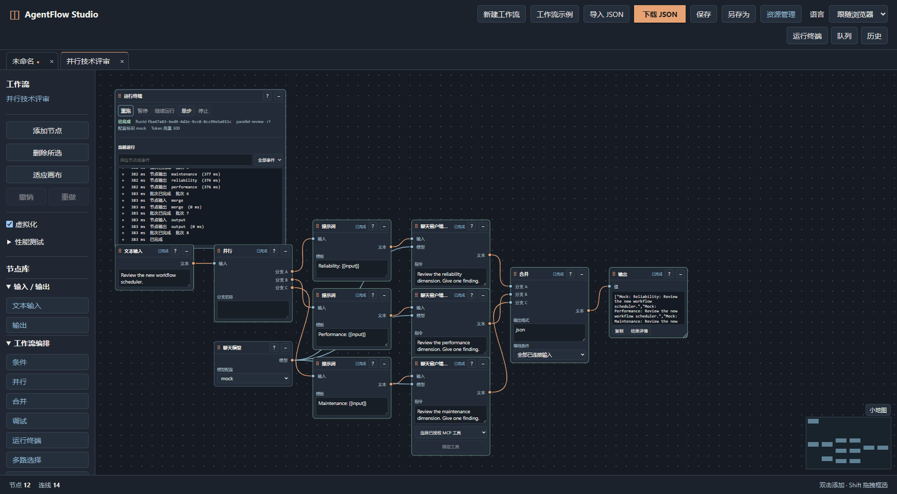
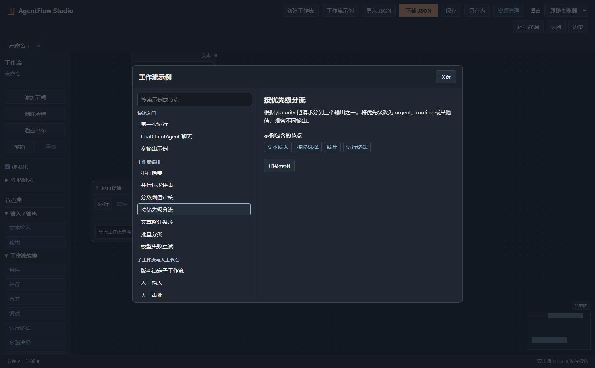
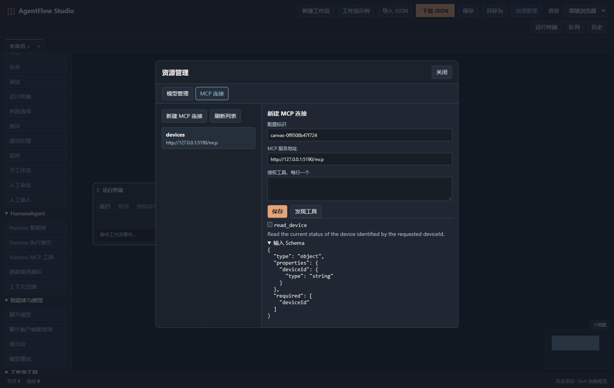
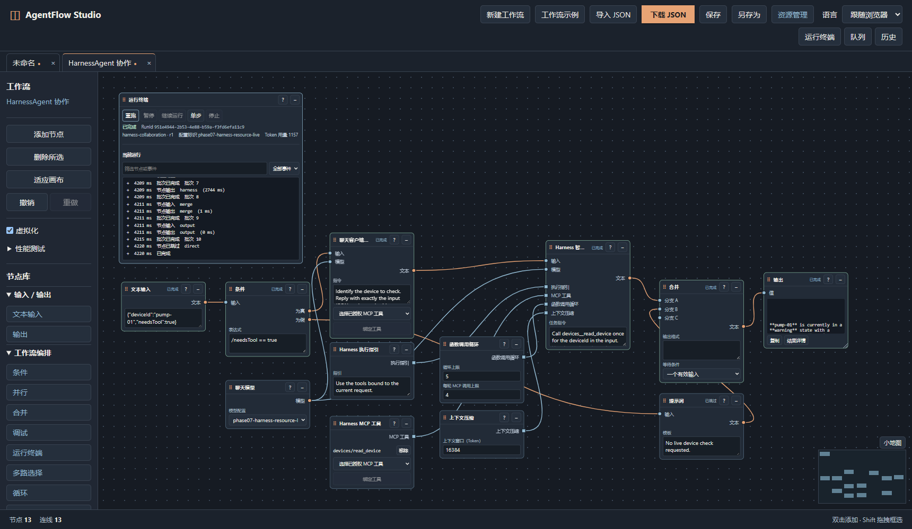
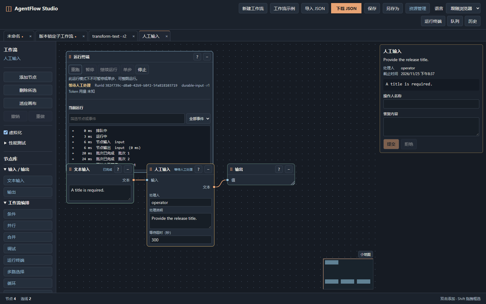

# AgentFlow Studio

AgentFlow Studio 是一个基于 **Microsoft Agent Framework（MAF）** 的可视化工作流开发工具。你可以在浏览器画布上连接文本输入、数据处理、Agent、工具和输出节点，并通过运行终端查看每一步实际发生了什么。工作流可保存为 JSON，也可由应用通过 HTTP API 提交。[MAF Workflow 官方文档](https://learn.microsoft.com/en-us/agent-framework/concepts/workflows/)

*并行技术评审示例。三个 Agent 使用同一个模型配置，分别处理可靠性、性能和可维护性问题。合并节点汇总结果，运行终端展示实际执行顺序。*

## 可以用它做什么

- **搭建可重复执行的 Agent 流程**。把模型调用和数据转换接进显式的执行图，用条件边、并行与合并表达业务规则。
- **让 Agent 使用受控工具**。从 MCP 查询设备状态，或在固定步骤读取 HTTP 接口、文件和 SQLite，再把结果交给 Agent 分析。
- **把人工处理接入流程**。在流程中等待补充信息或审批。符合检查点恢复条件的任务可在宿主重启后接着处理。
- **定位多节点执行问题**。按 RunId 找到一次执行，查看输入、输出、模型及工具请求、节点耗时和错误。

## 主要功能

| 能力 | 使用方式 |
| --- | --- |
| **可视化编排** | 拖入节点并连接消息端口与资源端口。支持条件、多路选择、并行、合并、循环、逐项处理、延时和模型重试。节点标题栏的 `?` 提供参数、端口和 MAF 对应说明。 |
| **Agent 与模型** | 将 `ChatClientAgent` 和 `HarnessAgent` 作为工作流执行单元。模型在「资源管理」维护，画布选择已保存的配置。HarnessAgent 可分别连接执行指引、MCP 工具、函数调用循环和上下文压缩资源。 |
| **数据和外部工具** | 用提示词、变量、JSON 指针、字段映射与 JSON Schema 校验处理数据。可直接调用已授权的只读 MCP 工具，也可让 Agent 根据任务选择工具。 |
| **可复用子工作流** | 把连好的节点封装为子工作流，调用节点绑定具体版本。发布子工作流修改后，可只更新当前调用节点。 |
| **人工输入与审批** | 显示负责人、处理说明和截止时间。NodeHost 在人工等待时使用 MAF Checkpoint 保存运行进度，在相同构建、配置和数据目录下可继续原 RunId。 |
| **运行终端与 Output** | 支持运行、暂停、继续、单步和停止。控制台逐行显示事件，点击日志可定位节点并查看详情。每个 Output 显示自己的业务结果，支持调整大小、复制和下载长文本或 JSON。 |
| **示例与编辑体验** | 顶栏提供可搜索的示例弹窗。每个示例列出操作说明、节点和前置条件，加载到新标签页。画布支持多标签、浏览器草稿、撤销重做、小地图、JSON 导入导出和三种界面语言。 |
| **Node SDK 扩展** | .NET 插件可声明节点的参数、类型化端口、文档及执行工厂，注册后可在画布使用。仓库附带文本拼接与 JSON 字段提取示例。 |

## 快速开始

以下命令使用 Windows PowerShell 7。安装 [`global.json`](global.json) 中指定的 .NET SDK（当前为 **10.0.404**）。后续命令均从仓库根目录执行。

~~~powershell
git clone https://github.com/lx6648580/AgentFlow.git
Set-Location AgentFlow

dotnet restore AgentFlow.slnx --locked-mode
dotnet build AgentFlow.slnx -c Release --no-restore
~~~

### 1. 启动 NodeHost

NodeHost 提供节点目录、资源管理和运行 API。以下命令在本地数据目录保存配置和运行记录，并加载仓库附带的 Node SDK 示例插件。

~~~powershell
$env:AGENTFLOW_RUN_DATA = Join-Path (Get-Location) 'work/run-data'
$env:AGENTFLOW_NODE_PLUGINS = (Resolve-Path 'examples/AgentFlow.SampleNodes/bin/Release/net10.0/AgentFlow.SampleNodes.dll').Path

dotnet run --project src/AgentFlow.NodeHost -c Release --no-build --no-launch-profile --urls http://127.0.0.1:5188
~~~

### 2. 启动 Studio

另开一个 PowerShell，从仓库根目录执行：

~~~powershell
dotnet run --project poc/AgentFlow.Editor.POC -c Release --no-build --no-launch-profile --urls http://127.0.0.1:5187
~~~

### 3. 运行第一个示例

1. 打开 [本地 Studio](http://127.0.0.1:5187/)，点击顶栏 **工作流示例**。
2. 选择 **第一次运行**，阅读说明后点 **加载示例**。
3. 在画布的 **运行终端**点 **运行**。流程会去除输入两端空白，经过短暂延时和调试节点，在 Output 显示 `Hello, AgentFlow!`。
4. 改写输入后试用 **单步**，点击日志行查看输入、输出和耗时。

**ChatClientAgent 聊天**和**并行技术评审**示例默认使用内置 `mock` 模型，可以直接运行。

## 接入模型和工具

### 模型配置

1. 打开 **资源管理 → 模型管理**，填写配置标识、OpenAI 兼容接口的 Base URL 和模型 ID。
2. 服务需要密钥时，在配置中填写 `SecretRef`，例如 `DEMO_MODEL`。在启动 NodeHost 的 PowerShell 中设置对应环境变量。非环回 Base URL 同时加入 `AGENTFLOW_MODEL_ENDPOINTS`。
3. 回到画布，在 **聊天模型**节点里选择已保存的配置。

~~~powershell
$env:AGENTFLOW_MODEL_ENDPOINTS = 'https://your-provider.example/v1'
$env:AGENTFLOW_MODEL_KEY_DEMO_MODEL = Read-Host -MaskInput '模型 API 密钥'
~~~

将示例地址替换为实际配置的 Base URL。工作流 JSON 保存模型配置标识，密钥由 NodeHost 在运行时从环境变量读取。[模型配置实现](src/AgentFlow.NodeHost/ModelProfiles.cs)

### MCP 和本地设备示例

在 **资源管理 → MCP 连接**中填写服务地址，发现工具，查看输入 Schema，并勾选要授权的只读工具。画布上的 **MCP 工具**节点可在固定步骤调用它，**ChatClientAgent** 或 **Harness MCP 工具**可把它绑定到 Agent。

仓库内置设备服务，提供模拟设备的 HTTP、MCP、文件和 SQLite 示例数据。另开一个 PowerShell 执行：

~~~powershell
$env:AGENTFLOW_SAMPLE_DATA = Join-Path (Get-Location) 'work/device-demo'

dotnet run --project examples/AgentFlow.DeviceSample -c Release --no-build --no-launch-profile --urls http://127.0.0.1:5190
~~~

在 NodeHost 的 PowerShell 中设置以下变量，再启动或重启 NodeHost：

~~~powershell
$env:AGENTFLOW_TOOL_ROOT = Join-Path (Get-Location) 'work/device-demo'
$env:AGENTFLOW_TOOLS_CONFIG = (Resolve-Path 'examples/AgentFlow.DeviceSample/tools.demo.json').Path
~~~

打开 **工作流示例 → 直接调用 MCP**，选择 `devices/read_device`。把参数里的 `deviceId` 改为 `pump-02` 后运行，可在 Output 查看设备状态，在终端查看工具请求和结果。要体验 Agent 自行决定何时调用工具，可加载 **HarnessAgent 协作**。[设备示例工具策略](examples/AgentFlow.DeviceSample/tools.demo.json)

查看 MCP 资源管理截图

查看 HarnessAgent 协作截图

### 人工节点与调试

加载 **人工输入**，运行后可在右侧以示例处理人 `operator` 提交文本。加载 **人工审批**可体验批准和拒绝。审批后的写入是本机模拟步骤，需在 NodeHost 启动前设置 `AGENTFLOW_SIMULATED_WRITES=1`。

查看人工输入等待截图

串行工作流可按节点单步执行。分支或并行图按 MAF 批次推进。带人工等待的工作流采用 Checkpoint 执行路径，可在终端查看运行过程，在 **历史**中查看已保存的日志。

## 通过 API 运行

保持 NodeHost 运行。下面使用默认 `mock` 的聊天示例，提交后可再次查询相同的 RunId。

~~~powershell
$hostUrl = 'http://127.0.0.1:5188'
$workflow = Get-Content 'fixtures/phase03/chat.workflow.json' -Raw | ConvertFrom-Json
$payload = @{
    workflow = $workflow
    requestId = [guid]::NewGuid().ToString()
} | ConvertTo-Json -Depth 50

$run = Invoke-RestMethod -Method Post -Uri "$hostUrl/api/runs" -ContentType 'application/json' -Body $payload
Invoke-RestMethod -Uri "$hostUrl/api/runs/$($run.runId)"
~~~

| 接口 | 用途 |
| --- | --- |
| `POST /api/runs` | 提交工作流和请求 ID。同一次提交重试时沿用原请求 ID。 |
| `GET /api/runs/{id}` | 查询状态、错误和 Output 结果。 |
| `GET /api/runs/{id}/events?after=<sequence>` | 按序号增量读取运行事件。 |
| `POST /api/runs/{id}/control` | 控制启用了交互模式的运行，支持暂停、继续和步进。 |
| `POST /api/runs/{id}/decision` | 提交人工输入、批准或拒绝。 |
| `GET /api/conversations/{id}` | 查询通过会话 API 成功保存的多轮记录。 |

应用使用稳定的 `conversationId` 绑定一段对话，每一轮提交新的 `requestId`。支持会话的工作流按 Agent 节点保留会话状态，多 Output 场景通过 `replyOutputId` 指定回复出口。[运行契约](src/AgentFlow.NodeSdk/RunContracts.cs) · [NodeHost API](src/AgentFlow.NodeHost/Program.cs)

## 项目结构

| 路径 | 职责 |
| --- | --- |
| [`poc/AgentFlow.Editor.POC`](poc/AgentFlow.Editor.POC) | Blazor WebAssembly 编辑器、节点库、模型与 MCP 管理、运行终端。 |
| [`src/AgentFlow.NodeHost`](src/AgentFlow.NodeHost) | 校验并编译工作流 JSON，执行 MAF 工作流，处理资源调用、运行队列、日志、会话和检查点。 |
| [`src/AgentFlow.NodeSdk`](src/AgentFlow.NodeSdk) | 工作流与节点契约、节点目录、参数校验和 SDK 插件执行入口。 |
| [`examples`](examples) | SDK 示例插件和本地设备服务。 |
| [`fixtures`](fixtures) · [`schemas`](schemas) | 工作流示例、回归夹具和 JSON Schema。 |
| [`tests`](tests) | .NET、NodeHost 和 Playwright 浏览器测试。 |

## 测试

构建后可单独运行工作流格式、SDK 和本地执行测试：

~~~powershell
dotnet test AgentFlow.slnx -c Release --no-build --filter 'Category!=Browser&Category!=Benchmark&Category!=RunHost&Category!=LiveModel'
~~~

完整功能回归使用 Studio、NodeHost、本地设备服务和 Playwright Chromium。CI 脚本提供了可复用的启动、环境变量和测试命令。真实模型及性能测试可分别通过 `Category=LiveModel` 和 `Category=Benchmark` 选择。[GitHub Actions 验证流程](.github/workflows/editor.yml)
